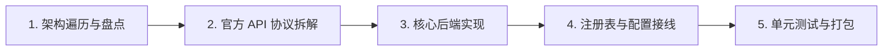
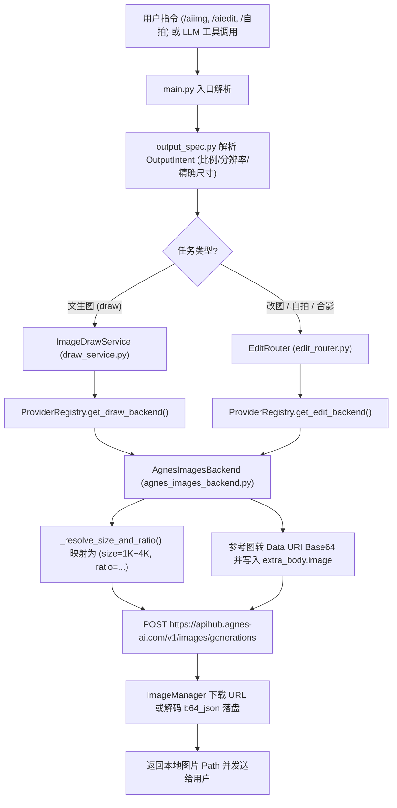

# Agnes AI 生图模型 (`agnes_images`) 适配开发流程与原理详解

本文档梳理了在 `astrbot_plugin_gitee_aiimg` 中从零适配 **Agnes AI 生图/改图模型 (`agnes_images`)** 的完整开发流程、架构调用链以及核心协议原理。

---

## 一、 整体开发流程

整个适配工作分为 **5 个阶段**，从项目既有架构盘点到最终单测与打包验证：



### 阶段 1：遍历现有项目架构
在动手编码前，先遍历项目核心目录以明确插件中“图片后端”与“视频后端”的边界：
1. **对比既有 Agnes 视频服务**：项目原有的 [`AgnesVideoService`](file:///Users/david/Downloads/astrbot_plugin_gitee_aiimg-main/core/agnes_video_service.py#L140-L725) 对接的是 `/v1/videos` 异步创建 + `/v1/videos/{id}` 轮询下载接口，且受 `RPM=1`（61 秒间隔）强约束，只服务于 `features.video.chain`。
2. **梳理图片生成与编辑契约**：
   - 文生图由 [`ImageDrawService`](file:///Users/david/Downloads/astrbot_plugin_gitee_aiimg-main/core/draw_service.py) 调度，要求后端实现 `generate(prompt, **kwargs) -> Path` 以及可选的 `resolve_output_intent(intent: OutputIntent) -> dict`。
   - 改图、Bot 自拍、多人合影由 [`EditRouter`](file:///Users/david/Downloads/astrbot_plugin_gitee_aiimg-main/core/edit_router.py) 调度，要求后端实现 `edit(prompt, images: list[bytes], **kwargs) -> Path`，并通过 `supports_edit` 与 `supports_ordered_references` 属性声明其参考图能力。
   - 所有服务商实例统一由 [`ProviderRegistry`](file:///Users/david/Downloads/astrbot_plugin_gitee_aiimg-main/core/provider_registry.py#L54-L664) 校验并构建。

### 阶段 2：拆解 Agnes Image 官方协议与差异点
查阅 Agnes AI 官方文档（`agnes-image-2.5-flash` / `2.1-flash` / `2.0-flash`），定位它与标准 OpenAI Images 接口的 **3 个核心差异**：

> [!IMPORTANT]
> **为什么不能直接复用 [`OpenAICompatBackend`](file:///Users/david/Downloads/astrbot_plugin_gitee_aiimg-main/core/openai_compat_backend.py)？**
> 1. **改图不走 `/v1/images/edits` 表单上传**：Agnes 的文生图、单图改图、多图融合统一走 `POST /v1/images/generations` 的 JSON 请求，参考图放在 JSON 内的 `extra_body.image` 数组中。
> 2. **`extra_body` 必须是字面量嵌套对象**：OpenAI Python SDK (`AsyncOpenAI`) 会把调用时传入的 `extra_body={...}` 展开平铺到 HTTP JSON 顶层；而 Agnes 服务端要求 HTTP 请求体里**真正存在名为 `"extra_body"` 的二级字典**（包含 `image` 和 `response_format`），一旦平铺到顶层就会触发 `HTTP 400`。
> 3. **尺寸控制采用 `size`（档位）+ `ratio`（画幅）双字段**：Agnes 支持 `1K` / `2K` / `3K` / `4K` 四个档位与 8 种 `ratio`；若直接传入常规像素尺寸（如 `1920x1080` 或 `2048x1152`），上游会因为不匹配内置精确像素表而回退到 1K。

### 阶段 3：实现专用后端 [`AgnesImagesBackend`](file:///Users/david/Downloads/astrbot_plugin_gitee_aiimg-main/core/agnes_images_backend.py)
基于 `httpx.AsyncClient` 编写无 OpenAI SDK 依赖的独立后端 [core/agnes_images_backend.py](file:///Users/david/Downloads/astrbot_plugin_gitee_aiimg-main/core/agnes_images_backend.py)，完整覆盖文生图、改图、多图顺序参考、尺寸映射、多 Key 轮询与重试。

### 阶段 4：全链路配置、注册表与前端工作台接线
1. **输出规格扩展**：在 [core/output_spec.py](file:///Users/david/Downloads/astrbot_plugin_gitee_aiimg-main/core/output_spec.py#L16) 中将分辨率正则从 `([124][kK])` 扩展为 `([1234][kK])`，使命令和自然语言提示词支持 `3K` 档位。
2. **注册表接入**：在 [core/provider_registry.py](file:///Users/david/Downloads/astrbot_plugin_gitee_aiimg-main/core/provider_registry.py) 中注册 `agnes_images`（及别名 `agnes`、`agnes_image`），加入 `_REQUEST_MODE_PROVIDER_TEMPLATES`、[`validate`](file:///Users/david/Downloads/astrbot_plugin_gitee_aiimg-main/core/provider_registry.py#L291-L321) 和 [`_build_backend`](file:///Users/david/Downloads/astrbot_plugin_gitee_aiimg-main/core/provider_registry.py#L597-L619)。
3. **Schema 与 WebUI 联动**：在 [_conf_schema.json](file:///Users/david/Downloads/astrbot_plugin_gitee_aiimg-main/_conf_schema.json#L406-L497) 新增 `"agnes_images"` 模板（显示名“Agnes 图”）。由于映像工作台前端（[pages/studio/app.js](file:///Users/david/Downloads/astrbot_plugin_gitee_aiimg-main/pages/studio/app.js)）通过 `!p.__template_key.includes("video")` 区分图片与视频服务商，命名为 `agnes_images` 后，WebUI 的文生图、改图、自拍链路及节点工作流即自动支持该服务商。

### 阶段 5：单元测试与插件打包
编写 [tests/test_agnes_images_backend.py](file:///Users/david/Downloads/astrbot_plugin_gitee_aiimg-main/tests/test_agnes_images_backend.py) 并在 [tests/test_provider_registry_request_modes.py](file:///Users/david/Downloads/astrbot_plugin_gitee_aiimg-main/tests/test_provider_registry_request_modes.py#L649-L709) 增加注册与实例化测试，最后剔除 macOS `__MACOSX` 隐藏目录生成符合 AstrBot `inspect_plugin_archive` 校验规范的 ZIP 包。

---

## 二、 架构与调用链原理

### 1. 插件内完整调用链路



### 2. 请求与响应时序

```mermaid
sequenceDiagram
    participant Router as DrawService / EditRouter
    participant Backend as AgnesImagesBackend
    participant Agnes as Agnes API (/v1/images/generations)
    participant IMgr as ImageManager

    Router->>Backend: generate() 或 edit(prompt, images, aspect_ratio, resolution)
    Backend->>Backend: _resolve_size_and_ratio() 计算 (size, ratio)
    opt 存在参考图 (改图 / 自拍 / 合影)
        Backend->>Backend: 校验 <=8 张且单图 <10MB，编码为 data:image/...;base64
        Backend->>Backend: 组装 payload["extra_body"]["image"] = [...]
    end
    Backend->>Agnes: POST /v1/images/generations (Bearer API_KEY轮询)
    alt HTTP 429 / 5xx 且可重试
        Agnes-->>Backend: 返回错误 + Retry-After
        Backend->>Backend: 指数退避等待并切换下一个 API Key 重试
        Backend->>Agnes: 重新发送 POST
    end
    Agnes-->>Backend: HTTP 200 {"data": [{"url": "...", "b64_json": ...}]}
    Backend->>IMgr: download_image(url) 或 save_image(b64_bytes)
    IMgr-->>Backend: 本地缓存文件路径 Path
    Backend-->>Router: 返回 Path
```

---

## 三、 四大核心技术设计详解

### 1. 智能尺寸与画幅逆向映射（[`_resolve_size_and_ratio`](file:///Users/david/Downloads/astrbot_plugin_gitee_aiimg-main/core/agnes_images_backend.py#L371-L497)）
Agnes 上游支持 4 个清晰度档位（`1K`、`2K`、`3K`、`4K`）与 8 种画幅（`1:1`、`3:4`、`4:3`、`16:9`、`9:16`、`2:3`、`3:2`、`21:9`），对应 [core/agnes_images_backend.py](file:///Users/david/Downloads/astrbot_plugin_gitee_aiimg-main/core/agnes_images_backend.py#L48-L87) 中的 `AGNES_IMAGE_SIZE_MAP`（共 32 组精确像素值）。

为了让用户的各种输入方式都能在 Agnes 上获得正确的高清尺寸，[`_resolve_size_and_ratio`](file:///Users/david/Downloads/astrbot_plugin_gitee_aiimg-main/core/agnes_images_backend.py#L371-L497) 实现了多源归一化：
- **自适应参数直传**：如 `/aiimg 海边日落 16:9 4K`，解析出 `aspect_ratio="16:9", resolution="4K"`，直接转为 `{"size": "4K", "ratio": "16:9"}`。
- **常规像素尺寸自动逆向归档**：若用户或预设传入 `2048x1152`（常规 2K 16:9，但不在 Agnes 的 `2624x1472` 像素表中），[`_tier_from_exact_size`](file:///Users/david/Downloads/astrbot_plugin_gitee_aiimg-main/core/agnes_images_backend.py#L140-L157) 会根据长边像素自动归档为 `2K`，[`_ratio_from_exact_size`](file:///Users/david/Downloads/astrbot_plugin_gitee_aiimg-main/core/agnes_images_backend.py#L160-L192) 会计算宽高比归档为 `16:9`，最终向 Agnes 发送 `{"size": "2K", "ratio": "16:9"}`，从而拿到真正的 `2624x1472` 2K 图，避免被上游降级为 1K。
- **近似比例兼容**：当上游收到 `4:5` 或 `5:4` 时，通过 `_ADAPTIVE_RATIO_FALLBACKS` 平滑映射为 Agnes 支持的 `3:4` 与 `4:3`。

### 2. 多图顺序参考与免拼图合成（`supports_ordered_references = True`）
在本插件中，当执行 **“Bot 自拍 + 指定穿搭参考图”** 或 **“多人身份合影”** 时，提示词会明确引用“图1（人物身份）”、“图2（服装参考）”。
- 如果后端不支持多图顺序传输，[`EditRouter`](file:///Users/david/Downloads/astrbot_plugin_gitee_aiimg-main/core/edit_router.py) 会被迫把多张图拼接成一张网格拼图（Collage）再发给模型，容易导致构图污染或分辨率下降。
- [`AgnesImagesBackend`](file:///Users/david/Downloads/astrbot_plugin_gitee_aiimg-main/core/agnes_images_backend.py#L226) 声明了 `supports_ordered_references = True`。当 `EditRouter` 调用 [`edit(..., require_ordered_references=True)`](file:///Users/david/Downloads/astrbot_plugin_gitee_aiimg-main/core/agnes_images_backend.py#L742-L796) 时，后端通过 [`_encode_image_bytes_to_data_uri`](file:///Users/david/Downloads/astrbot_plugin_gitee_aiimg-main/core/agnes_images_backend.py#L211-L220) 自动识别每张图的真实 MIME 类型（PNG / JPEG / WebP / GIF），按严格顺序编码为 `data:image/<mime>;base64,...` 写入 `payload["extra_body"]["image"]`，最多支持 8 张参考图。

### 3. `extra_body` 协议隔离与防冲突设计
在 [`build_payload`](file:///Users/david/Downloads/astrbot_plugin_gitee_aiimg-main/core/agnes_images_backend.py#L516-L598) 中：
- 将 `image` 和 `response_format` 严格收敛到 `payload["extra_body"]` 内部；
- 当本次请求处于 `require_ordered_references=True`（严格顺序参考模式，如自拍/合影）时，自动忽略用户在静态配置 `extra_body.image` 中遗留的固定参考图，防止固定图篡改图 1 / 图 2 的序号对应关系；
- 使用 `copy.deepcopy` 拷贝 `self.extra_body`，保证单次请求不会污染服务商实例的全局配置。

### 4. 多 Key 轮询、智能退避重试与密钥脱敏
- **多 Key 轮询**：[`_next_key`](file:///Users/david/Downloads/astrbot_plugin_gitee_aiimg-main/core/agnes_images_backend.py#L298-L303) 维护轮询游标 `self._key_index`，每次请求（含重试）自动切换 `api_keys` 列表中的下一个 Key 分摊并发与限流。
- **退避重试**：[`_post_generations`](file:///Users/david/Downloads/astrbot_plugin_gitee_aiimg-main/core/agnes_images_backend.py#L600-L672) 针对网络抖动及 HTTP `408 / 409 / 425 / 429 / 500 / 502 / 503 / 504` 自动重试，优先读取响应头的 `Retry-After` 秒数，缺省采用指数退避。
- **密钥脱敏**：[`_redact`](file:///Users/david/Downloads/astrbot_plugin_gitee_aiimg-main/core/agnes_images_backend.py#L305-L310) 会在抛出异常或记录日志前将所有已配置的 API Key 替换为 `[redacted]`，避免上游报错回显 Key 时造成泄露。

---

## 四、 涉及文件清单

| 文件路径 | 作用说明 |
| :--- | :--- |
| [core/agnes_images_backend.py](file:///Users/david/Downloads/astrbot_plugin_gitee_aiimg-main/core/agnes_images_backend.py) | 新增 Agnes 生图/改图/多图合成后端核心实现 |
| [core/output_spec.py](file:///Users/david/Downloads/astrbot_plugin_gitee_aiimg-main/core/output_spec.py) | 扩展自然语言提示词与输出规格中的 `3K` 分辨率识别 |
| [core/provider_registry.py](file:///Users/david/Downloads/astrbot_plugin_gitee_aiimg-main/core/provider_registry.py) | 注册 `agnes_images` 模板及别名，实现配置校验与后端构建 |
| [_conf_schema.json](file:///Users/david/Downloads/astrbot_plugin_gitee_aiimg-main/_conf_schema.json) | 新增 `agnes_images`（“Agnes 图”）WebUI 可视化配置 Schema |
| [tests/test_agnes_images_backend.py](file:///Users/david/Downloads/astrbot_plugin_gitee_aiimg-main/tests/test_agnes_images_backend.py) | Agnes 生图后端完整单元测试（尺寸映射、多图参考、重试、脱敏、非法参数拦截） |
| [tests/test_provider_registry_request_modes.py](file:///Users/david/Downloads/astrbot_plugin_gitee_aiimg-main/tests/test_provider_registry_request_modes.py) | 注册表对 `agnes_images` 模板与别名的解析与构建测试 |
| [docs/providers.md](file:///Users/david/Downloads/astrbot_plugin_gitee_aiimg-main/docs/providers.md) / [docs/configuration.md](file:///Users/david/Downloads/astrbot_plugin_gitee_aiimg-main/docs/configuration.md) / [README.md](file:///Users/david/Downloads/astrbot_plugin_gitee_aiimg-main/README.md) | 同步补充 Agnes 生图配置示例与尺寸映射说明 |
